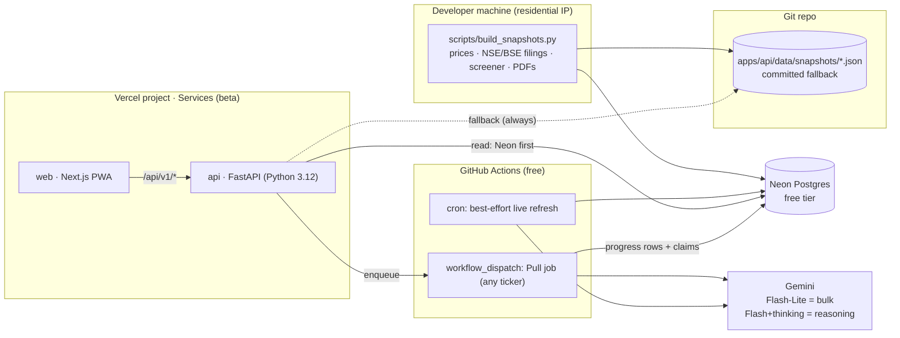

# FINN — Financial Investment Agent

**What changed, why it matters, and who you know who can explain it.**
A mobile-first PWA for a public-markets investor. It has three layers:

- **Push**: a time-windowed, prioritised digest of corporate filings across the portfolio, plus alerts on thresholds you set (unusual volume or price moves, announcement categories you care about).
- **Pull**: on-demand research on **any NSE ticker**, grounded *only* in annual reports and concall transcripts. Every claim carries a verified citation.
- **Network**: the investor's own network as an intelligence layer. It appears *inside* Push and Pull ("who to call, and why") and can also be queried directly.

> Built for the ENAM Founding AI Engineer Build Challenge (Nov 2026). The brief and glossary are in [`docs/`](docs/).
> The 3-minute walkthrough is [`docs/DEMO_SCRIPT.md`](docs/DEMO_SCRIPT.md). Every decision and tradeoff is in [`docs/DECISIONS.md`](docs/DECISIONS.md).

---

## Architecture



**Principles**
1. **The demo never breaks.** Every read path goes Neon → committed JSON snapshot. Every live fetcher detects blocked or empty responses and falls back loudly. A freshness chip in the UI always says where the data came from.
2. **Nothing slow runs inside a request.** Pull research runs as a background job that writes progress rows, and the UI polls.
3. **Citations are enforced in code.** An extracted claim survives only if its verbatim quote fuzzy-matches the stored page text.
4. **Private network data never goes to an LLM.** Network ranking and paths are deterministic code.
5. **Cheap by design.** Rules first, the small model for bulk work, the thinking model only for reasoning, and a cache keyed by content hash. Every LLM call is logged with tokens and cost.

---

## Repo layout

```
apps/web/            Next.js 16 (App Router) PWA — the product
apps/api/            FastAPI service (Vercel Python) — read API + Pull pipeline
  finn/fetchers/     prices, nse, bse, screener  (each with snapshot fallback)
  finn/pipeline/     classify, results, mgmt, alerts
  finn/research/     ingest, extract, verify, reason, dossier
  finn/network/      graph, resolve, rank, intents
  finn/llm/          router, cache, ledger, prompts
  data/seed/         portfolio, research set, synthetic network
  data/snapshots/    committed fallbacks (prices, filings, doc text, dossiers)
scripts/             build_snapshots.py, make_icons.py, check_models.py, seed_db.py
docs/                brief PDFs, DECISIONS.md, DEMO_SCRIPT.md
vercel.json          Services: web + api in one project
```

---

## Running locally

Prereqs: Node 22+ and [uv](https://docs.astral.sh/uv/) (`brew install uv`). uv installs Python 3.12 for you.

```bash
# 1. API
cd apps/api
uv sync --all-groups
uv run uvicorn main:app --reload --port 8000

# 2. Web (second terminal). Dev server proxies /api/v1/* to :8000
cd apps/web
npm install
npm run dev
# open http://localhost:3000 (or your LAN IP on a phone)
```

Or run both exactly as production does: `vercel dev` from the repo root.

### Environment variables
See [`.env.example`](.env.example). **All are optional for the demo**: with no key and no DB, the app serves committed snapshots and says so.

| Var | Used by | Purpose |
|---|---|---|
| `GEMINI_API_KEY` | api, scripts | Google AI Studio key (free tier) |
| `FINN_MODEL_BULK` / `FINN_MODEL_STRONG` | api, scripts | Override model names (verified by `scripts/check_models.py`) |
| `DATABASE_URL` | api, scripts | Neon Postgres connection string |
| `GITHUB_DISPATCH_TOKEN` / `GITHUB_REPO` | api | Lets the API enqueue Pull jobs via `workflow_dispatch` |

---

## Deploying

```bash
vercel login           # once
vercel link            # from repo root
vercel deploy          # preview
vercel deploy --prod   # production
```

## Data & privacy, in one paragraph
Market data and filings are public and come from Yahoo Finance, NSE/BSE and screener.in. **The investor network in this demo is entirely synthetic.** Real people appear only where they are named in a public filing, and their profile is taken only from that filing. Any link between a synthetic contact and a real person is *inferred from employer/tenure overlap* and labelled as such in the UI. For how this would work with real data (consented import, user-supplied exports, licensed providers, owner-scoped storage with retention limits), see DECISIONS D-008 and D-009.
